# GPT-2 Activation Atlas — Stage 1: the neuron atlas

*Ryan Reece, 2026-10-26, updated 2026-10-28. Design: [atlas-design.md](atlas-design.md).*

## Contents

- [Summary](#summary)
- [Setup](#setup)
- [1. Residual-stream geometry](#1-residual-stream-geometry)
- [2. Offset dimensions in the residual stream](#2-offset-dimensions-in-the-residual-stream)
- [3. MLP neurons](#3-mlp-neurons)
- [4. Single units](#4-single-units)
- [5. Errors: statistical and file to file](#5-errors-statistical-and-file-to-file)
- [6. Corpus systematic: OpenWebText vs FineWeb vs Python code](#6-corpus-systematic-openwebtext-vs-fineweb-vs-python-code)
- [7. Deep scan of layers 0–2: rare and never-firing neurons](#7-deep-scan-of-layers-02-rare-and-never-firing-neurons)
- [8. Position and context length](#8-position-and-context-length)
- [9. Dependence on centering the residual stream](#9-dependence-on-centering-the-residual-stream)
- [10. Systematic uncertainties](#10-systematic-uncertainties)
- [11. Validation](#11-validation)
- [Caveats](#caveats)
- [Next](#next)

## Summary

A first look at what GPT-2 small does over 1M OpenWebText tokens, from the stage 1 atlas: statistics for all 36,864
MLP neurons and 9,984 residual-stream dimensions (13 hook points × 768), with bootstrap errors over 16 shards in 8
files. The same atlas on 1M tokens each of FineWeb and Python code measures how much of it depends on the corpus, a
50M-token deep scan of layers 0–2 separates rare neurons from silent ones, and a 512-token atlas measures how the
statistics depend on position in the context. Running the same tokens without centering the residual stream checks
the last processing convention. Stage 2, the same atlas in SAE feature bases, is in [results-stage2.md](results-stage2.md).

- **The residual stream grows and then collapses.** Its total variance grows about 4800× from the embedding to the
  final residual. Its effective dimension rises from 14 to about 170 in layers 7–9, then collapses to about 7 at the
  final residual, where the top principal component alone carries 34% of the variance.
- **A few residual dimensions are constant offsets.** Dimensions 64, 266, 326, 373, 447 and 481 sit many standard
  deviations away from zero on almost every token. The covariance view subtracts the mean, so it does not see them.
  They are the same dimensions on all three corpora.
- **Rarely-firing MLP neurons live in layers 0–2** (170 of the 183 neurons that fire on fewer than 1 in 10⁴ tokens),
  and they are mostly the same neurons on every corpus. Layer 1's median neuron fires on 29% of tokens, at least twice
  as often as any other layer's.
- **89 neurons in layers 0–2 never fire in 50M tokens.** The deep scan checked the 100 there that never fired on
  3 × 1M tokens: 11 are merely rare, and 89 stay silent (rate below 6×10⁻⁸). About a third of those stay well below
  threshold, the closest thing to dead neurons a sample can show; another third come within 0.5 of firing.
- **The corpus matters, and code matters most.** Against the difference between two halves of OpenWebText, FineWeb
  moves a typical unit 14–18× further and Python code 85–133× further. On code the residual stream's effective
  dimension stays near 25 at every layer, against up to 170 on web text.
- **Errors are small, and files of one corpus are near replicates.** A unit's mean is known to about 0.002 of its
  spread. The errors now include the variation from one file of the corpus to the next, which the deep scan bounds at
  about 0.0003 of a unit's spread; it adds only 2–6% to the error.
- **Position matters most at the start of the context.** Layer 1's high firing rate builds up over the first ~16
  positions (5% at position 1, 29% from 16 on), and the offset dimensions are largest at position 1 and decay with
  position. Beyond about position 16, statistics change little out to 511, and long documents look like the rest.
- **Centering the residual stream changes almost nothing.** Raw (uncentered) residuals differ from the TransformerLens
  convention only along the all-ones direction, which carries at most 0.1% of the variance; MLP neurons are identical.
- **Every stored exemplar reproduces.** Recomputing sampled top- and bottom-k pointers returns the stored values to
  2e-6 relative.

These are initial results: up to 512-token windows, three corpora and the neuron basis only. The caveats are listed
at the end.

## Setup

| | |
| --- | --- |
| Model | GPT-2 small, TransformerLens processed convention (folded LayerNorm, centered writing weights) |
| Data | 1M tokens per corpus, one random 127-token window per document, with documents sampled across each whole file |
| Corpora | OpenWebText (default): 7,816 rows, 977 from each of files 0–7. FineWeb sample-10BT and codeparrot-clean (Python): 7,814 rows from files 0 and 1. Revisions pinned in each `manifest.json` |
| Tokens | 992,632 per unit for OpenWebText; position 0 (BOS) excluded from all statistics |
| Hooks | MLP `hook_post` in layers 0–11; residual stream before each layer and after the last ("layer 12") |
| Errors | bootstrap over 16 shards in 8 files: resampling files (total error) or shards within files (statistical), see §5 |
| Compute | about 4 min per corpus on an M4 (MPS) for the run, 1–3 min to tokenize, about 3.5 min to export (two bootstraps over 16 shards) |

Sections 1–5 are OpenWebText; section 6 compares the corpora; section 7 is a 50M-token deep scan of layers 0–2;
section 8 is position and context length, from a 512-token atlas; section 9 is the dependence on centering the
residual stream.

To reproduce: `source setup.sh`, then `run-atlas` (OpenWebText into `results/atlas/`),
`run-atlas results/atlas-fineweb 1e6 fineweb`, `run-atlas results/atlas-code 1e6 code`, the runs in §7–§9, and
`run-notebook`, which runs `notebooks/atlas.ipynb` headless, in place, and writes every figure here into
`docs/figures/`. The FineWeb and code atlases here were built with 2 files, before the default became 8.

## 1. Residual-stream geometry

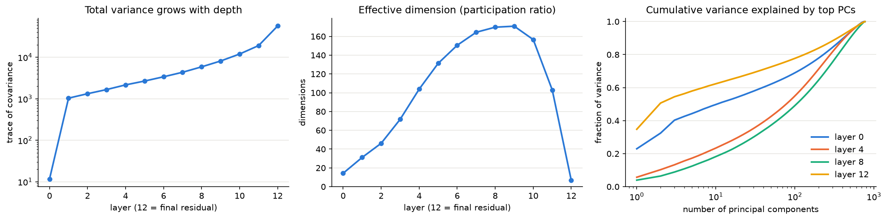

| Layer | Total variance | Effective dimension | PCs for 90% of variance | Largest basis dimension (share) |
| --- | --- | --- | --- | --- |
| 0 | 11.6 ± 0.0 | 14.3 ± 0.0 | 411 | 479 (2%) |
| 1 | 1,033 ± 1 | 31.2 ± 0.0 | 314 | 480 (7.5%) |
| 4 | 2,157 ± 1 | 104.0 ± 0.1 | 424 | 480 (4%) |
| 8 | 5,861 ± 4 | 170.7 ± 0.3 | 500 | 447 (2%) |
| 9 | 8,109 ± 7 | 171.8 ± 0.3 | 507 | 447 (2%) |
| 11 | 19,070 ± 21 | 104.1 ± 0.5 | 510 | 496 (2.5%) |
| 12 (final) | 56,097 ± 199 | 6.8 ± 0.0 | 348 | 496 (10.5%) |

The effective dimension is the participation ratio (Σλ)²/Σλ² of the covariance eigenvalues. Errors are the total
bootstrap error (§5). The notebook prints every layer.

- **Variance.** The first block multiplies the variance by 89 (layer 0 is the embedding alone). After that it grows
  steadily, by 54× from layer 1 to the final residual, with the last block alone contributing 2.9×.
- **Effective dimension.** It rises through the middle layers, where the variance is spread most evenly (the top PC
  carries only 4% at layer 8), then collapses in the last two blocks. At the final residual a handful of directions
  dominate, which is what `ln_final` and the unembedding then read.
- **Basis dimensions.** Dimension 480 stands out early (7.5% of the variance at layer 1, down to 2% by layer 7). From
  layer 7 to 11 no basis dimension carries more than 2.5%, so which one is largest there means little. At the final
  residual, dimensions 496, 430 and 36 carry 10.5%, 8% and 8%.

## 2. Offset dimensions in the residual stream

The covariance in §1 is taken about the mean, so it is blind to dimensions that are large but nearly constant. Ranking
residual dimensions by |mean| / std picks out a small, stable set:

| Dimension | Layer 1 | Layer 6 | Layer 11 | Layer 12 (final) |
| --- | --- | --- | --- | --- |
| 64 | −23.7 ± 2.0 | −27.2 ± 2.2 | −28.1 ± 2.2 | −118.9 ± 35.2 |
| 373 | −16.2 ± 4.0 | −21.3 ± 4.6 | −93.8 ± 17.9 | −143.0 ± 39.1 |
| 447 | 17.3 ± 4.4 | 32.0 ± 8.0 | 89.4 ± 17.6 | 127.5 ± 38.8 |
| 266 | 11.3 ± 2.5 | 11.7 ± 2.4 | 11.9 ± 2.7 | — |
| 326 | 9.3 ± 1.7 | 10.5 ± 2.4 | — | — |
| 481 | — | — | 92.8 ± 18.8 | 133.3 ± 38.7 |

Entries are mean ± standard deviation over tokens (not errors on the mean), and "—" means |mean| < 3 std at that
layer. In all, 79 (layer, dimension) pairs pass |mean| > 3 std: 16 small ones at layer 0, the six dimensions in the
table (481 only from the later layers), dimension 101 at layer 1 only, and dimensions 87 and 480 at the final residual
only.

Dimensions 64, 266 and 326 are switched on by the first block and then barely change. Dimensions 373, 447 and 481 grow
steadily with depth. This resembles the outlier ("massive activation") dimensions reported for GPT-2 and other
transformers. §6 shows they are the same dimensions on FineWeb and code, so they belong to the model, not the data.
Whether they act as biases that later LayerNorms divide out, or carry information in their small variations, is a
question for stage 2.

## 3. MLP neurons

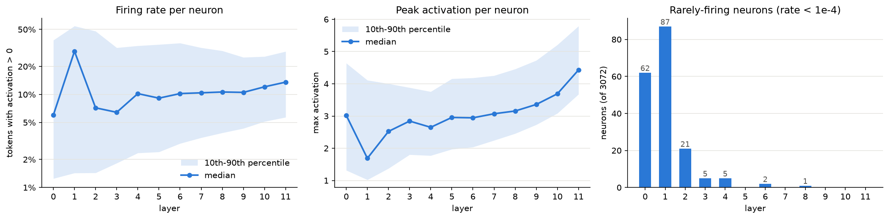

A neuron "fires" when its post-GELU activation is above 0.

- **Firing rates.** Layer 1 is the outlier: its median neuron fires on 29% of tokens, against 6–14% in every other
  layer. From layer 4 on the median rises slowly, from about 9–10% to 14%.
- **Peak activations** climb through the last layers. The five highest-peak neurons are all in layers 10–11, led by
  L11/2378 (max 57, next highest 24).
- **Rarely-firing neurons** (rate < 1e-4, fewer than about 100 of 1M tokens) number 62, 87 and 21 in layers 0–2, and
  13 across all later layers. 122 neurons never fire at all in this sample, and 110 never fire on any of the three
  corpora (§6). With 3M tokens, "never" only bounds the rate below about 1 in 10⁶; §7 scans layers 0–2 over 50M
  tokens to tell rare from silent.

## 4. Single units

The atlas keeps each unit's histogram and its top-20 exemplars as `(row, pos)` pointers, decoded here with the token
marked «like this». Residual dimensions are signed, so they also keep bottom-20.

**L11/2378, the highest-peak neuron.** It fires on 5.8% of tokens. Every top-10 context is the first newline of a
blank line «⏎»⏎ at the end of a paragraph or list item, usually closing a quote. Above zero the histogram has two
bumps, a broad one near 10 and a sharper one near 35–40.

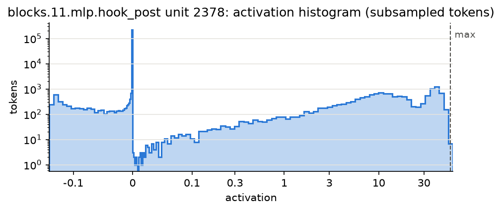

**L9/1000, a typical mid-depth neuron.** It fires on 7.9% of tokens and peaks at 3.2. Its top contexts are mostly
determiners and pronouns in set phrases: "one of «a» number", "the first of «a» string of attacks", "of «their»
choice", "on «the» recommendation". Ten exemplars are not enough to name what it does. Its histogram is in
[figures/results_neuron_l9_1000.png](figures/results_neuron_l9_1000.png).

**Residual dimension 447 at layer 9, both extremes.** This is one of the offset dimensions from §2 (mean 49, std 12),
positive on 99.9% of tokens.

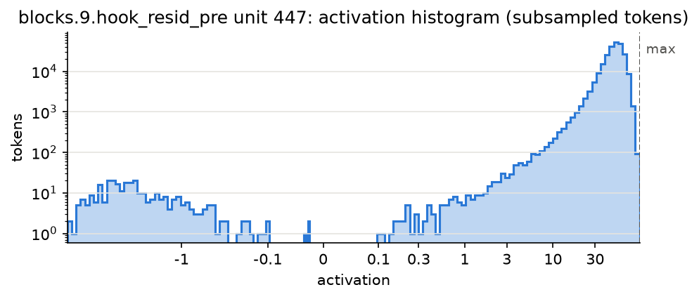

| Side | Value | Context |
| --- | --- | --- |
| top | 104.2 | …In nutshell, «Su»ave complements Azure… |
| top | 100.5 | …By default, «Retro»fit does the JSON… |
| top | 99.2 | …This probably means «Hus»k will combine its… |
| top | 98.7 | …returning to nostalgic locations. «Cron»o snickered… |
| bottom | −29.8 | …get three actions in your «inbox» every week. |
| bottom | −22.7 | …Absorb 20 dragon souls⏎⏎21.1%⏎⏎«Rare» 30.43% |
| bottom | −21.1 | …pic.twitter.com«/»w3tp4… |
| bottom | −19.1 | …You must select a newsletter to subscribe to. «Sign» Up… |

The largest values fall on the first token of a capitalized name or an unfamiliar product word, often the first of
several BPE pieces. The most negative fall in boilerplate and list text: newsletter sign-up lines, URL paths, a stats
table. The bottom side only exists because of the bottom-k added in this round: top-k alone shows half the picture for
a signed unit.

## 5. Errors: statistical and file to file

`export` gives two bootstrap errors on every unit's statistics and on each layer's total variance and effective
dimension:

- **`*_err_stat`**, the statistical error, resamples the 16 shards within each of the 8 files.
- **`*_err`**, the total error, resamples whole files instead (a cluster bootstrap), so it also covers the variation
  from one file of the corpus to the next.

Both are corrected for the few resampling units. A bootstrap over G units underestimates the variance by (G − 1)/G,
which with 2 shards per file would make the statistical error √2 too small.

| Median error | MLP neurons: total / stat | Residual dims: total / stat |
| --- | --- | --- |
| on the mean, in units of std | 0.0021 / 0.0021 | 0.0025 / 0.0024 |
| on the std, relative | 0.0054 / 0.0053 | 0.0012 / 0.0011 |
| on the firing rate, relative | 0.0068 / 0.0065 | — |

An error of 0.002 std on a mean corresponds to roughly 250k effective samples out of 1M tokens: tokens within one
document, and documents within one shard, are correlated.

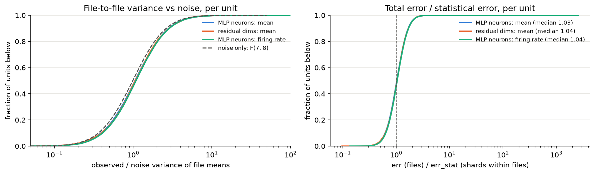

**The file-to-file term is real but small.** For each unit, the variance of its 8 file means can be compared with the
variance expected from noise alone, estimated from the scatter of each file's 2 shards; with no file effect their
ratio follows F(7, 8), median 0.99.

- **In the 1M atlas** the median ratio is 1.06–1.08, but each file holds under 1k documents, so a file mean carries
  noise of about 0.005 of a unit's spread and the term is poorly resolved. All 36k units also share the same 8 files,
  so they are not independent tests.
- **The 50M-token deep scan (§7)** reads about half of the documents in the same 8 files, so its file means are close
  to the files' true means. There the file-to-file std is about 0.0003 of a unit's spread for means (median ratio
  1.12) and 0.0001 for firing rates (1.03).
- **Effect on the errors.** The total error exceeds the statistical error by 2–6% at both 1M and 50M tokens. At a
  much larger scale per file the file term would grow in relative weight, which `*_err` would then capture.

**Two corrections to earlier versions of these results.**

- **Errors were about 13% too small.** Earlier errors used 4 shards per file without the small-sample correction.
- **The file difference was overstated.** An earlier version reported that OpenWebText files 0 and 1 differ by about
  0.0015 of a unit's spread. That came from a single pair of files, one realization shared by every unit, and the
  deep scan shows the true file-to-file term is 5–10× smaller. The files are statistical replicates to this
  precision.

## 6. Corpus systematic: OpenWebText vs FineWeb vs Python code

The same pipeline, sampling and 1M-token budget, run on two more corpora: FineWeb (sample-10BT; filtered Common Crawl,
web text like OpenWebText but a different selection) and Python code (codeparrot-clean, from GitHub).

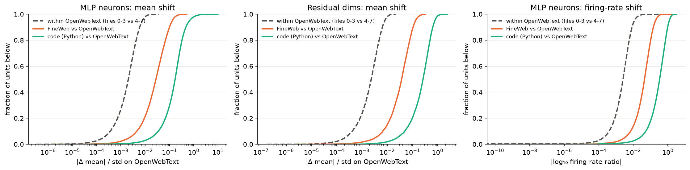

Each curve is the distribution, over units, of a unit's shift from OpenWebText: |Δ mean| in units of its spread on
OpenWebText, or for firing rates the |log₁₀ ratio|. The dashed curve is a within-OpenWebText floor: the same shift
between files 0–3 and files 4–7, scaled by 1/√2 to full-size samples.

| Median shift | FineWeb | Python code | Within-OpenWebText floor |
| --- | --- | --- | --- |
| MLP neurons: mean, in units of std | 0.028 (14×) | 0.172 (85×) | 0.0020 |
| Residual dims: mean, in units of std | 0.037 (16×) | 0.263 (113×) | 0.0023 |
| MLP neurons: \|log₁₀ firing-rate ratio\| | 0.045 (18×) | 0.335 (133×) | 0.0025 |

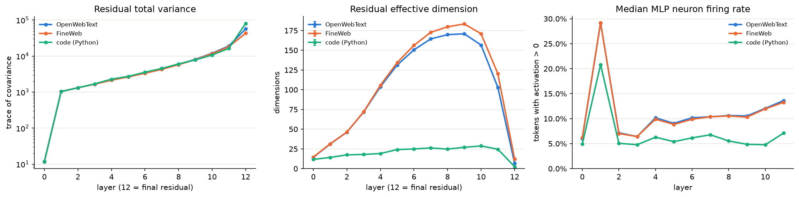

| Layer | Effective dimension: OpenWebText | FineWeb | Python code |
| --- | --- | --- | --- |
| 1 | 31.2 | 31.4 | 14.2 |
| 4 | 104.0 | 105.7 | 19.1 |
| 9 | 171.8 | 183.4 | 27.1 |
| 11 | 104.1 | 120.3 | 24.6 |
| 12 (final) | 6.8 | 12.1 | 2.5 |

Bootstrap errors are at most ±0.5.

- **FineWeb** follows OpenWebText closely in shape but sits clearly above the floor. Its effective dimension is higher
  from about layer 6 on, and its total variance at the final residual is 23% lower. Firing rates per layer are almost
  identical.
- **Code** differs from the first block on:
  - Its effective dimension stays near 25 at every layer, and at the final residual the top PC carries 61% of the
    variance (34% for OpenWebText).
  - Its neurons fire less: the median is 5–7% after layer 1, and 21% in layer 1.
  - Its total variance at the final residual is 43% higher.

  A likely cause is code's token statistics. 37% of its tokens are pure whitespace (indentation), against 2–4% for web
  text, and its ten most common token types cover half of all tokens, against about a quarter. That would let a few
  directions carry much of the variance, but the atlas alone does not prove it.
- **What does not depend on the corpus.**
  - The same residual dimensions are offsets on all three corpora, with similar means through layer 11: FineWeb
    within 4% of OpenWebText and code within 4–17%, except dimension 326 (up to 14% and 69% larger).
  - The rarely-firing neurons are mostly the same neurons: 168 are rare on every corpus, and 110 never fire on any.
  - Layer 1 is the high-firing layer on all three.
- **Code-specific neurons.** A few early neurons are nearly silent on web text and fire on code. L0/2469 fires on
  0.04% of OpenWebText tokens and 30% of code tokens, with its top code context on indentation; L1/1323 goes from 0.06%
  to 13%, with its top context on a run of escaped tabs (`"\t\t…"`) in a string. In the other direction, L4/961 fires
  on 9.6% of OpenWebText tokens and 0.01% of code tokens.

## 7. Deep scan of layers 0–2: rare and never-firing neurons

The atlases see 1M tokens per corpus, too few to tell a neuron that fires once in 10⁷ tokens from one that never
fires. The deep scan runs only layers 0–2, which hold 100 of the 110 neurons that never fired on any corpus, over
49.6M OpenWebText tokens: 390,632 documents from files 0–7, one window each. The forward pass stops after layer 2,
so it runs at about 22k tokens/s (38 min on an M4, plus 7 min to tokenize).

It records the MLP pre-activation (`mlp.hook_pre`) rather than the post-GELU value. GELU keeps the sign, so the
firing rate is the same, but the pre-activation also says how far a silent neuron stays from firing: its maximum over
the scan, and the top-k contexts that come closest.

    python -m atlas tokenize results/deepscan-owt --n-tokens 5e7 --files 0,1,2,3,4,5,6,7
    python -m atlas run results/deepscan-owt --shards 16 --hooks 'blocks.[0-2].mlp.hook_pre'
    python -m atlas export results/deepscan-owt

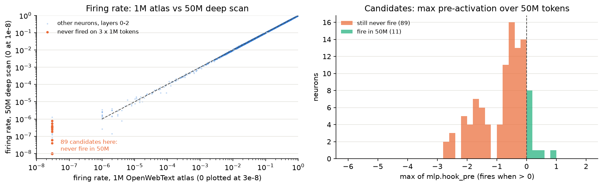

| Layer | Candidates (never fired on 3 × 1M tokens) | Fire in 50M tokens | Still never fire |
| --- | --- | --- | --- |
| 0 | 29 | 4 | 25 |
| 1 | 58 | 4 | 54 |
| 2 | 13 | 3 | 10 |
| **Total** | **100** | **11** | **89** |

- **89 never fire**, which bounds their rate below 6×10⁻⁸ (3 in 50M, 95% CL). The other 11 are rare rather than
  silent, firing 2–39 times each.
- **How far from firing.** Over 50M tokens, 31 of the 89 never come within 1 unit of threshold. L1/242 has mean −9.6,
  std 1.6 and max −2.6; it is as close to dead as a sample can show. Another 32 come within 0.5: L0/1382 reaches
  −0.03, so for these "never" may only mean "rarer than 1 in 50M". For all 89, zero lies 2.9–21 standard deviations
  above the mean pre-activation (median 6.2).
- **Closest approaches look like features.** The contexts that come nearest to firing are specific, much like live
  neurons' top contexts. L0/1382 peaks on "ref…" word pieces («ref»rained, «ref»old), and L2/2980 on the newline that
  closes a quoted paragraph. Of the 11 that do fire, L0/2206 (39 times) fires on «hub» and «Mac» in place names and
  product names ("tourist «hub»", "Vegan Cheddar «Mac» & Cheese"), and L1/1966 (27 times) on the «MORE» link that
  follows an inline headline in political news ("…emergency declaration «MORE» on Tuesday…").
- **Rare neurons get enough examples.** For the 58 rare neurons in layers 0–2, the median number of firing tokens goes
  from 10 in the 1M atlas to 512.
- **Consistency.** Where both measure a rate well (above 0.1%), the deep scan's firing rates match the 1M atlas's:
  median ratio 1.000, 1st–99th percentile 0.97–1.03. The deep scan also measures the file-to-file term (§5).
- **Silent on OpenWebText is not silent everywhere.** Two more layer 1 neurons, 1822 and 2400, never fire in the 50M
  OpenWebText tokens, with maxima just below 0 (−0.02 and −0.01). Yet they fired on 1M tokens of code, 33 and 2 times.

## 8. Position and context length

Every statistic above pools positions 1–127 of 128-token windows. A 512-token atlas measures how the statistics depend
on position, out to 511: 2M OpenWebText tokens from 3,912 documents of at least 511 tokens (files 0–7), with
`run --positions`. That adds moments per position bucket for every unit (`positions.parquet`; buckets 1, 2–3, 4–7, …,
256–511) and a residual covariance per coarse bucket (`resid_positions.npz`; 1–7, 8–31, 32–127, 128–511).

    python -m atlas tokenize results/atlas-512 --n-tokens 2e6 --seq-len 512
    python -m atlas run results/atlas-512 --shards 16 --positions
    python -m atlas export results/atlas-512

GPT-2's attention is causal, so positions 1–127 of a 512-token window compute exactly what a 128-token window of the
same text would. "Context length" is therefore position: the longer windows add positions 128–511. The only other
difference is which documents qualify, since a 512-token window needs a document of at least 511 tokens.

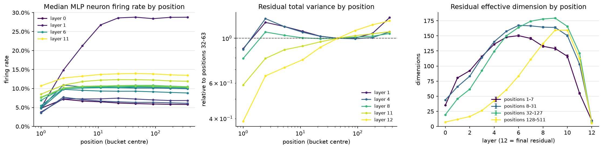

**Firing rates.** Median MLP neuron firing rate by position:

| Layer | 1 | 2–3 | 4–7 | 8–15 | 16–31 | 32–63 | 256–511 |
| --- | --- | --- | --- | --- | --- | --- | --- |
| 0 | 4.8% | 7.2% | 6.7% | 6.5% | 6.2% | 6.0% | 5.8% |
| 1 | 5.0% | 14.8% | 21.3% | 26.8% | 28.6% | 28.8% | 28.8% |
| 6 | 5.5% | 10.0% | 10.1% | 10.2% | 10.2% | 10.4% | 10.2% |
| 11 | 10.7% | 12.8% | 13.2% | 13.7% | 13.9% | 14.0% | 13.5% |

Layer 1's high firing rate (§3) is a property
of position: its median neuron fires on 5% of tokens at position 1 and builds up over the first ~16 positions to 29%.
Every layer fires least at position 1, and from about position 16 on firing rates are nearly flat out to 511.

**Offset dimensions.** The offset dimensions of §2 are largest at the start of the context and decay with position
(mean over tokens):

| Dimension, layer | 1 | 4–7 | 16–31 | 64–127 | 256–511 |
| --- | --- | --- | --- | --- | --- |
| 447, layer 11 | 124.8 | 108.5 | 93.4 | 84.1 | 80.4 |
| 481, layer 11 | 131.5 | 113.3 | 96.8 | 87.4 | 81.8 |
| 373, layer 1 | −26.7 | −25.2 | −18.9 | −14.0 | −12.9 |
| 64, layer 1 | −14.7 | −21.0 | −24.7 | −23.3 | −22.2 |

Most lose a third to a half of their size between position 1 and 256–511, with the steepest change in the first ~30
positions. Dimension 64 is the exception: it starts smaller and settles by position 16.

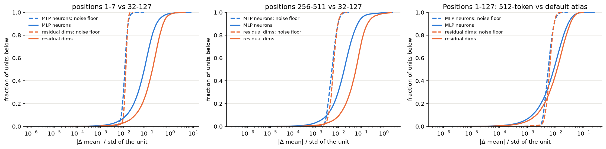

**Per-unit position dependence.** For every unit, the shift of its mean between position buckets, in units of its
spread, against a noise floor from the bootstrap errors of the two buckets:

| Median \|Δ mean\| / std | MLP neurons (floor) | Residual dims (floor) |
| --- | --- | --- |
| positions 1–7 vs 32–127 | 0.077 (0.011) | 0.17 (0.012) |
| positions 256–511 vs 32–127 | 0.018 (0.005) | 0.058 (0.006) |
| positions 1–127: long documents vs the default atlas | 0.009 (0.005) | 0.011 (0.006) |

- **Early positions** differ the most, 7–14× the floor.
- **Late positions** differ by much less, 3.5–10× the floor: real but small, mostly in the residual stream.
- **Long documents** (at least 511 tokens) differ from the default atlas's documents (at least 127) by under 2× the
  floor, a third of the FineWeb shift (§6). The 128-token results carry over to long documents.

**Caution: covariance by position mixes in the position embedding.** A bucket's covariance includes the variation
between the positions inside it as well as between tokens at the same position. At layer 0, the position embedding
alone is 51% of the variance in positions 128–511 (9–24% in the narrower buckets), and it lies almost entirely in about
2 directions. That is why the widest bucket's effective dimension collapses to 7 at layer 0. The effective-dimension
and total-variance panels above therefore measure position spread as well as token content, and only the qualitative
picture is safe: at the final residual the effective dimension falls with position, from 9.7 (positions 1–7) to 5.5
(128–511). Separating the two needs a covariance within each position, the next step for this section.

## 9. Dependence on centering the residual stream

Everything above follows TransformerLens's processed convention, as the pretrained SAEs do. For what the atlas reads,
that convention does one thing: it removes each token's mean over d_model from the residual stream. Centering the
weights that write to the stream is linear, so it equals subtracting that mean. (Folding LayerNorm leaves MLP
activations unchanged.) The `hf-raw` backend skips the centering, on the same tokens as the default atlas:

    python -m atlas run results/atlas-raw --shards 16 --backend hf-raw   # tokens.npy copied from results/atlas

The raw residual is the centered one plus m·**1**, where m is the token's mean over the 768 dimensions. The all-ones
direction is orthogonal to everything in the centered stream, so the raw total variance is the centered one plus the
variance along **1**, exactly, and any change in effective dimension comes from that single direction.

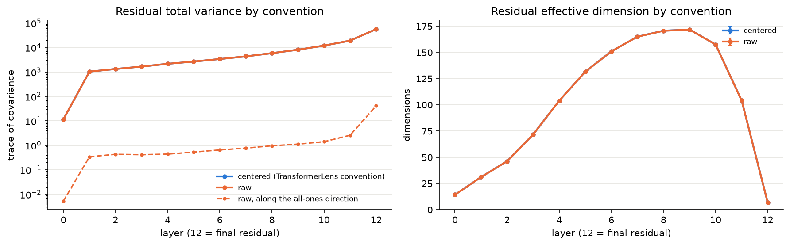

| Layer | Total variance: centered | Raw | Along the all-ones direction (share) | Mean of m | Std of m | Effective dimension: centered / raw |
| --- | --- | --- | --- | --- | --- | --- |
| 0 | 11.6 | 11.7 | 0.0 (0.0%) | −0.002 | 0.003 | 14.3 / 14.3 |
| 4 | 2,156.7 | 2,157.1 | 0.4 (0.0%) | −0.018 | 0.024 | 104.0 / 103.9 |
| 8 | 5,861.2 | 5,862.2 | 1.0 (0.0%) | 0.025 | 0.035 | 170.7 / 170.6 |
| 11 | 19,070.0 | 19,072.6 | 2.6 (0.0%) | 0.173 | 0.058 | 104.1 / 104.1 |
| 12 (final) | 56,096.7 | 56,138.3 | 41.5 (0.1%) | −0.094 | 0.233 | 6.8 / 6.8 |

- **MLP neurons are identical,** to the last bit (maximum difference 0), as expected: LayerNorm removes the mean
  before every MLP.
- **The all-ones direction is nearly empty.** A token's mean over d_model is on average −0.09 to 0.17, with a spread
  of 0.003–0.23 across tokens, against unit spreads that grow from about 0.1 to over 8 with depth. It carries at most
  0.1% of the raw variance. Raw minus centered total variance equals the variance along **1** at every layer, as it
  must.
- **Nothing downstream changes.** Effective dimensions agree within errors at every layer. The offset dimensions are
  the same: 79 (layer, dimension) pairs either way, 78 in common, and the other one sits at the 3-std threshold. Their
  means move by at most 0.2.

LayerNorm removes the mean before every block reads the stream, so the model gets almost no training signal along the
all-ones direction, which is consistent with it staying nearly empty. For GPT-2 small this systematic is negligible.
It would matter for a model or tool where that direction is not nearly empty.

## 10. Systematic uncertainties

Every systematic measured so far, ranked by size. Sizes are median shifts of a unit's mean over all units, in units of
that unit's spread (std), unless noted.

| Source | How measured | Typical size | Relative to the statistical error | Verdict |
| --- | --- | --- | --- | --- |
| [Corpus: Python code](#6-corpus-systematic-openwebtext-vs-fineweb-vs-python-code) | code vs OpenWebText, 1M tokens each | 0.17 (MLP), 0.26 (residual); firing rates change by a factor of ~2.2 | ~100× | Dominant: a different regime, with effective dimension ~25 against ~170 |
| [Position: the first ~7 tokens](#8-position-and-context-length) | positions 1–7 vs 32–127, 512-token atlas | 0.08 (MLP), 0.17 (residual) | 7–14× its floor | Large: layer 1 fires on 5% of tokens at position 1 and 29% from 16 on; offsets are largest at position 1 |
| [Corpus: FineWeb](#6-corpus-systematic-openwebtext-vs-fineweb-vs-python-code) | FineWeb vs OpenWebText | 0.028–0.045 | 14–18× | Real but modest: web text against web text |
| [Position: late (256–511)](#8-position-and-context-length) | positions 256–511 vs 32–127 | 0.018 (MLP), 0.058 (residual) | 3.5–10× its floor | Small, mostly in the residual stream |
| [Long-document selection](#8-position-and-context-length) | documents of ≥511 vs ≥127 tokens, positions 1–127 | ~0.01 | under 2× | Near noise: the 128-token results carry over |
| [Statistical](#5-errors-statistical-and-file-to-file) | bootstrap over shards | **0.002** on a mean; 0.005 relative on a std; 0.007 relative on a firing rate | — | The reference scale |
| [File to file, within a corpus](#5-errors-statistical-and-file-to-file) | cluster bootstrap over files; the 50M-token deep scan | ≤ 0.0003 per file | adds 2–6% to the error | Negligible at this scale, and included in `*_err` |
| [Centering the residual stream](#9-dependence-on-centering-the-residual-stream) | raw vs TransformerLens-centered residuals | MLP: 0 exactly; residual: ≤ 0.1% of the variance, means move by ≤ 0.2 | — | Negligible for GPT-2 small |
| Backend: HF vs TransformerLens bridge ([design doc](atlas-design.md#stage-1-status)) | every hook; the full atlas | 2×10⁻⁵ of the activation scale; atlas statistics agree to ~10⁻⁵ relative | — | Negligible; 0.6% of top-k pointers swap among exact ties |
| Histogram subsampling ([design doc](atlas-design.md#stage-1-status)) | every 4th token vs every token | p99 quantiles move by a median 0.02 std (0.13 for the worst 1% of units) | — | Affects quantiles only |

The position rows compare one position bucket with another, so their floor is the error of a bucket (0.005–0.012 of
a unit's spread), not of the whole atlas (0.002).

**In short.** The atlas is precise: a unit's mean is known to about 0.2% of its spread, and every implementation choice
(backend, residual centering, merge arithmetic, which files of a corpus are read) sits well below that. What the
numbers mean depends on the data: the corpus (3–4% of a unit's spread for other web text, about 20% for code) and the
first ~16 positions of context move statistics 10–100× more than the statistical error. So a statement such as "neuron
X has mean m" should carry its statistical error and its conditions, "on OpenWebText, positions 1–127". Past position
~16, and for longer documents, those conditions matter much less.

**Not yet measured.**

- **Context beyond 511 tokens.** GPT-2 goes to 1024.
- **The row layout.** Rows put a BOS before a window that starts mid-document, unlike GPT-2's training windows; that
  may be part of why the first positions look special. One consequence is now seen: features that fire on document
  boundaries (a mid-prompt `<|endoftext|>`) never fire here ([stage 2 §2](results-stage2.md#2-the-atlas-in-the-sae-basis)). For OpenAI's SAEs a BOS hardly matters on positions within their context ([stage 2 §1](results-stage2.md#1-the-gate-into-stage-2)).
- **Covariance within each position.** Effective dimension by position (§8) is only qualitative so far.

## 11. Validation

Checks that the atlas computes what it claims, grouped by what they check against. The notebook reruns the first
group's checks and the calibration test with every run (notebook §12); the unit tests are in `tests/`.

**Exactness and internal consistency**

| Check | Result |
| --- | --- |
| Pointers reproduce: 12 random top- and bottom-k entries recomputed from `(row, pos)` | all match, worst relative difference 2.1e-6 |
| Position buckets pool back to the whole: each unit's buckets in the 512-token atlas (§8), merged, against its overall moments | counts equal; means agree to 1e-7 of a unit's spread, stds to 7e-7 relative, firing rates exactly |
| Deep scan vs the 1M atlas (§7): firing rates on different data, same code | median ratio 1.000, 1st–99th percentile 0.97–1.03 |
| Centering identity (§9): raw minus centered total variance against the variance along the all-ones direction | equal at every layer, as the decomposition requires |
| Unit tests: exact merging for every accumulator (split vs whole, including bottom-k and the position buckets), sampling across a file, hook selection, the file-level bootstrap and its small-sample correction, the uncentered backend, the SAE gate's splicing hook, SAE features and events in a run, IOI heads against processed TransformerLens, ioi-hydra's head-level result, the name-balanced prompts, the off-dictionary split and the resample-ablation round trip | 52 of 52 pass |

**Cross-implementation**

| Check | Result |
| --- | --- |
| Plain HF backend vs TransformerLens bridge, 7 hook types × layers 0, 5, 11 (`tests/test_backends.py`) | agree within 2e-5 of the activation scale; a run over a subset of hooks stops only after the last one reached |
| Full atlas, HF vs TransformerLens backend ([design doc](atlas-design.md#stage-1-status)) | statistics agree to ~1e-5 relative; 0.6% of top-k pointers swap among exact ties |

**External: published numbers**

| Check | Result |
| --- | --- |
| Known features of GPT-2 small's residual stream (§1, §2) | outlier dimensions (480 early, 447 in the middle layers, 496 at the final residual) and large constant offsets, consistent with the outlier ("massive activation") dimensions reported for GPT-2 |

**Statistical calibration**

| Check | Result |
| --- | --- |
| The file-to-file test (§5) under its null: shards shuffled across files, 20 permutations | median ratio 1.007 (range 0.88–1.14), against 0.990 for F(7, 8). The actual files give 1.061, inside that range: the 1M atlas alone cannot resolve the file-to-file term, which is why §5 measures it with the deep scan |
| Small-sample correction of the bootstrap (unit test) | the corrected cluster bootstrap recovers s / √G for a statistic that differs only between files |

**Data integrity**

| Check | Result |
| --- | --- |
| No document used twice, default atlas | 7,816 rows from 7,816 distinct (file, document) pairs, files 0–7 |
| Identical 127-token windows across documents | one window appears twice: newsletter boilerplate ("Sign up for Take Action Now and get three actions in your inbox every week") |
| No documents shared between OpenWebText files 0 and 1 (a one-off check, hashing all 100,173 documents of each) | none shared |

## Caveats

- **Few files for the other corpora.** The FineWeb and code atlases use 2 files each, so their errors are statistical
  only. On OpenWebText the file term adds only a few percent, but FineWeb (crawl dumps) and code (repositories) may
  vary more from file to file.
- **Context.** The main atlases cover positions 1–127 and the position study 1–511, not GPT-2's full 1024. Rows start
  mid-document after a BOS, which GPT-2 never saw in training, and that may be part of what makes the first positions
  special (§8).
- **Covariance by position mixes in the position embedding.** A position bucket's covariance includes the variation
  between the positions inside it, so the effective dimension by position (§8) is only qualitative.
- **The neuron basis.** Single neurons are often polysemantic, so a unit's top-10 contexts (as for L9/1000) may not
  name what it does. SAE bases are stage 2.
- **Thin tails.** In the 1M-token atlases, rare units have fewer than about 100 examples; the deep scan (§7) covers
  this for layers 0–2 only. Histograms (and so quantiles) use every 4th token.
- **Silent is not dead.** "Never fires" is always relative to a corpus and a sample size: two neurons silent on 50M
  OpenWebText tokens fire on code (§7).

## Next

From the [roadmap](atlas-design.md#roadmap):

- **Follow-ups for stage 1:** a covariance within each position, to separate token content from position spread
  (§8); deep scans of the 10 silent candidates in layers 3–6, and of code for the code-specific neurons.
