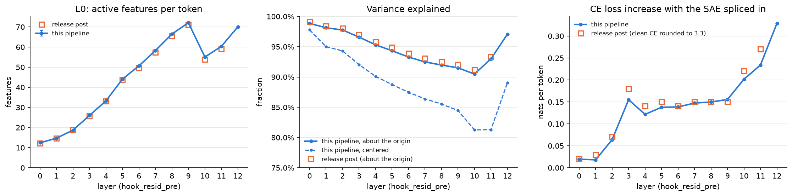
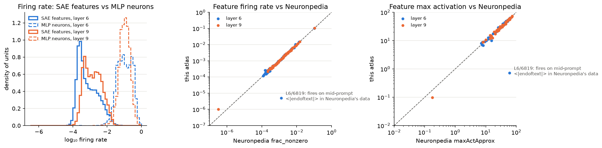
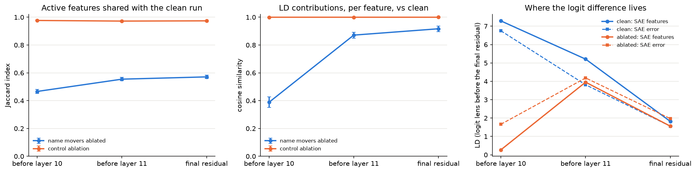
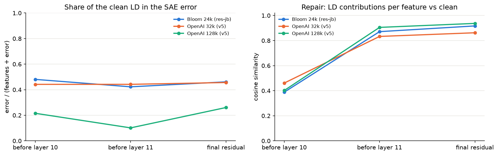
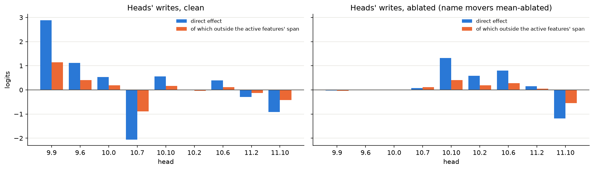

# GPT-2 Activation Atlas — Stage 2: SAE features

*Ryan Reece, 2026-10-26, updated 2026-10-28. Design: [atlas-design.md](atlas-design.md).*

## Contents

- [Summary](#summary)
- [Setup](#setup)
- [1. The gate into stage 2](#1-the-gate-into-stage-2)
- [2. The atlas in the SAE basis](#2-the-atlas-in-the-sae-basis)
- [3. The IOI repair in the SAE basis](#3-the-ioi-repair-in-the-sae-basis)
- [4. Systematic uncertainties](#4-systematic-uncertainties)
- [5. Validation](#5-validation)
- [Caveats](#caveats)
- [Next](#next)

## Summary

Stage 2 of the atlas: the residual stream in pretrained SAE feature bases. A gate first checks that each SAE
reproduces its release's metrics on this pipeline; the gate-validated SAEs then make their features atlas units at
layers 6 and 9; and the first research question, how GPT-2 small's IOI circuit repairs itself when its name-mover heads
are ablated, is answered in the feature basis with three dictionaries. Stage 1, the neuron atlas, its corpus and
position systematics and its validation, is in [results-stage1.md](results-stage1.md).

- **The gate into stage 2 passes.** Bloom's pretrained residual SAEs reproduce their release's L0, alive features,
  variance explained and CE loss on this pipeline, and our activations match TransformerLens's to 10⁻⁶.
- **OpenAI's SAEs pass within their training context.** Their 32k and 128k TopK SAEs reproduce sensibly on 64-token
  windows and fail beyond them; a BOS hardly matters (§1).
- **The atlas in the SAE basis.** At layers 6 and 9 the SAE features are atlas units, with sparse per-token events at
  layer 9. Single features match Neuronpedia's dashboards, and the SAE's decoder bias is the residual stream's mean.
- **The IOI repair restores the clean features.** With the name movers ablated, the logit difference at the final
  residual is carried by the same SAE features as in the clean run (cosine 0.86–0.94 in three dictionaries). With
  the 24k and 32k dictionaries about half of it sits in the SAE's error and shifts there under the repair; with a 128k
  dictionary only a quarter does, and the restoration is complete. The answer is carried mostly by "say this name"
  features, about four per name, and the off-dictionary rest is written by the circuit's own heads (§3).

The caveats are listed at the end.

## Setup

| | |
| --- | --- |
| Model | GPT-2 small on the plain HF backend, in TransformerLens's processed convention ([stage 1](results-stage1.md#setup)) |
| SAEs | Joseph Bloom's `gpt2-small-res-jb` (24,576 features at each `hook_resid_pre`, ReLU, L1-trained); OpenAI's `gpt2-small-resid-post-v5-32k` and `-128k` (TopK, k = 32, on `resid_post`), all via SAELens 6.54.12 |
| Gate and feature atlas data | the default OpenWebText atlas's tokens ([stage 1](results-stage1.md#setup)) |
| IOI data | ioi-hydra's 128 prompts and mean ablation, ported to `python/ioi.py`; a name-balanced set of 472 prompts |
| Errors | cluster bootstrap over files (gate, feature atlas); 95% bootstrap intervals over prompts (IOI) |

To reproduce: the stage 1 setup, then `run-sae-gate` and the runs in §1–§2, and `run-notebook` (notebook §9–§11).

## 1. The gate into stage 2

A pretrained SAE's features only mean something if our activations are the ones it was trained on: same hook point,
same processing convention, same BOS and context handling. The gate checks this before stage 2 uses any features. It
runs Joseph Bloom's `gpt2-small-res-jb` SAEs (24,576 features at each residual `hook_resid_pre`, layers 0–11) on
254,000 tokens per layer of the default atlas (250 rows from each of its 8 files), through our HF backend, and
compares the metrics with the
[release post](https://www.lesswrong.com/posts/f9EgfLSurAiqRJySD/open-source-sparse-autoencoders-for-all-residual-stream):

    run-sae-gate   # = python -m sae_gate results/atlas --out results/sae-gate; about 40 min on an M4

The SAEs' own metadata already matches this pipeline: trained on OpenWebText with 128-token contexts, a prepended BOS,
and centered writing weights, the convention of [stage 1 §9](results-stage1.md#9-dependence-on-centering-the-residual-stream). The metrics follow SAELens's definitions (`sae_lens.evals`):

- **L0**: nonzero features per token, without BOS.
- **Variance explained**, centered: 1 − E‖x − x̂‖² / (E‖x‖² − ‖E x‖²), SAELens's current definition; and about the
  origin, 1 − E‖x − x̂‖² / E‖x‖², as the release post computed it.
- **CE loss**: next-token cross-entropy with the reconstruction spliced in everywhere but BOS. The CE loss score is
  (CE_zero − CE_sae) / (CE_zero − CE_clean), with the zero ablation at every position.
- **Alive features**: features that fire at least once on these tokens.

| Layer | L0 (post) | Alive (post) | Variance explained, centered | About the origin (post) | CE increase (post) | CE loss score |
| --- | --- | --- | --- | --- | --- | --- |
| 0 | 12.4 (12.24) | 79.3% (80.0%) | 97.8% | 98.9% (99.15%) | 0.020 (0.02) | 0.999 |
| 1 | 14.7 (14.68) | 83.1% (83.4%) | 95.0% | 98.1% (98.37%) | 0.018 (0.03) | 0.996 |
| 2 | 18.7 (18.80) | 79.6% (80.0%) | 94.3% | 97.8% (98.07%) | 0.064 (0.07) | 0.987 |
| 3 | 26.0 (25.75) | 86.3% (86.3%) | 92.0% | 96.6% (96.97%) | 0.155 (0.18) | 0.985 |
| 4 | 33.3 (33.14) | 97.7% (97.7%) | 90.1% | 95.3% (95.77%) | 0.122 (0.14) | 0.992 |
| 5 | 44.1 (43.61) | 99.7% (99.7%) | 88.8% | 94.3% (94.90%) | 0.138 (0.15) | 0.989 |
| 6 | 50.6 (49.68) | 99.9% (100%) | 87.5% | 93.3% (93.90%) | 0.138 (0.14) | 0.987 |
| 7 | 58.3 (57.29) | 100% (100%) | 86.4% | 92.5% (93.08%) | 0.147 (0.15) | 0.985 |
| 8 | 66.5 (65.47) | 100% (100%) | 85.5% | 92.0% (92.57%) | 0.150 (0.15) | 0.981 |
| 9 | 72.1 (71.10) | 100% (100%) | 84.5% | 91.5% (92.05%) | 0.156 (0.15) | 0.989 |
| 10 | 55.1 (53.79) | 100% (100%) | 81.3% | 90.5% (91.12%) | 0.202 (0.22) | 0.976 |
| 11 | 60.3 (59.16) | 99.8% (100%) | 81.3% | 93.0% (93.30%) | 0.234 (0.27) | 0.965 |
| 12 (final residual) | 70.1 (—) | 100% (—) | 89.0% | 97.1% (—) | 0.329 (—) | 0.928 |

Row 12 is the SAE on the final residual stream (`blocks.11.hook_resid_post`), gated for §3; the release post has no
row for it, and SAELens's rough `expected_l0` is 70. The CE increase is CE_sae − CE_clean in nats per token; the post's is its CE with the SAE minus a clean CE it gives
only as "3.3", so it is uncertain by about ±0.05. Bootstrap errors over files are at most 0.13 on L0, 0.05 points on
variance explained and 0.0003 on the CE loss score.

**The gate passes.**

- **Conventions agree exactly.** On 32 rows per layer, our HF pipeline reproduces the residual stream of
  TransformerLens's `HookedTransformer`, loaded as SAELens recommends, to 3×10⁻⁶ relative, and its per-token losses
  to 10⁻⁴.
- **Every release metric matches.** L0 agrees with the post within 2.4% at every layer, alive features within 0.7
  points, variance explained about the origin within 0.7 points (always slightly below, by 0.2–0.6), and the CE increase within the rounding of the
  post's clean CE.
- **SAELens's built-in reference values for this release are rough.** Its `expected_l0` (10, 10, 18, 23, …) and
  `expected_var_explained` (0.999, 0.9, 0.77 in three tiers) are hand-entered approximations; the post's table is the
  reference to use.

Two differences, both understood:

- **Centered variance explained is 1–12 points lower than the post's.** The post divides by E‖x‖², which includes the
  residual stream's large constant offsets ([stage 1 §2](results-stage1.md#2-offset-dimensions-in-the-residual-stream)). The SAE reconstructs those almost for free with its decoder bias, so
  the gap grows with depth as the offsets do. The centered value is the more honest measure of how much of the
  stream's variation the SAE captures: 98% at layer 0, falling to 81% at layers 10–11.
- **Our clean CE is 3.50, against the post's 3.3.** The absolute loss depends on the evaluation text: our rows are a
  BOS plus a window starting mid-document, so early positions have little context. The increase from splicing in the
  SAE, which is what the gate tests, agrees.

With the gate passed, stage 2 can use these SAEs on this pipeline: feature atlases in the SAE basis, with the same
accumulators.

**OpenAI's SAEs.** The dictionary systematic of §3 also uses OpenAI's TopK SAEs for GPT-2 small (Gao et al. 2024;
32k and 128k features, k = 32, on `resid_post`), at the three points the IOI analysis needs. Their conventions differ
from Bloom's: each token is normalized to unit std before encoding (undone on decoding), and they were trained on
64-token contexts without a BOS. The normalization removes each token's mean, so centering does not matter ([stage 1 §9](results-stage1.md#9-dependence-on-centering-the-residual-stream)), but
the context does:

| Rows, OpenAI 32k SAE | Centered variance explained: before layer 10 / before layer 11 / final residual |
| --- | --- |
| BOS + 127 tokens (our rows) | 0.83 / 0.82 / 0.90 |
| No BOS, 64 tokens (their training format), all positions | 0.99 / 0.98 / 0.91 |
| BOS + 63 tokens | 0.84 / 0.83 / 0.90 |

The second row looks best but is misleading: without a BOS, position 0 is a real token that becomes the attention
sink, with about 20× the norm of the others, and it dominates the pooled variance while being easy to reconstruct
(0.6% error, against 26% for positions 1–63). Measured directly before layer 10, positions 1–63 are reconstructed
equally well with or without a BOS (0.84 either way), while positions 64–127, outside the training context, are
reconstructed worse than by the mean (−0.27). So these SAEs are only valid within 64 tokens, where a BOS makes little
difference, and the gate that matters for the IOI prompts (15–18 tokens with a BOS) is BOS + 63:

| BOS + 63 tokens | L0 | Centered variance explained | About the origin | CE loss score |
| --- | --- | --- | --- | --- |
| 32k, before layer 10 / 11 / final residual | 32 | 0.84 / 0.83 / 0.90 | 0.92 / 0.94 / 0.97 | 0.98 / 0.97 / 0.94 |
| 128k, before layer 10 / 11 / final residual | 32 | 0.87 / 0.86 / 0.91 | 0.94 / 0.95 / 0.98 | 0.99 / 0.98 / 0.96 |

Our activations match TransformerLens's for these SAEs too (residual stream within 10⁻⁵, per-token loss within
10⁻⁴), and variance explained about the origin is consistent with SAELens's rough reference of 0.9; there is no
per-layer published table to compare against.

## 2. The atlas in the SAE basis

With the gate passed, the gate-validated SAEs encode the residual stream inside the hooks, and their 24,576 features at
layers 6 and 9 become ordinary atlas units (`kind = "sae"`): firing rate, moments, histogram and top-20 contexts, on
the same 1M tokens as the default atlas, so features and neurons can be compared token for token. At layer 9 every
nonzero activation is also kept as a sparse event (`events-L9-*.parquet`: row, pos, feature, value), 71.5M of them
(454 MB), for per-token queries such as the IOI analysis to come.

    mkdir -p results/atlas-sae && cp results/atlas/{tokens.npy,docs.npy,manifest.json} results/atlas-sae/
    python -m atlas run results/atlas-sae --shards 16 --batch-size 32 --hooks 'blocks.6.hook_resid_pre,blocks.9.hook_resid_pre' \
        --sae gpt2-small-res-jb --sae-layers 6,9 --sae-events 9
    python -m atlas export results/atlas-sae

The run stops after layer 9, so it takes about 5 minutes on an M4 (3,600 tokens/s), plus the export.

| Layer | Features | Never fire (1M tokens) | Firing rate: 10% / median / 90% | Fire on > 1% of tokens | L0 | Median MLP neuron firing rate |
| --- | --- | --- | --- | --- | --- | --- |
| 6 | 24,576 | 13 | 0.018% / 0.055% / 0.55% | 1,043 | 50.7 | 10.2% |
| 9 | 24,576 | 3 | 0.035% / 0.14% / 0.75% | 1,494 | 72.1 | 10.5% |

- **Features are sparse, neurons are not.** The median feature fires about 75× (layer 9) to 185× (layer 6) less often
  than the median MLP neuron at the same layer, and almost no feature is dead over 1M tokens.
- **Single features match Neuronpedia.** Neuronpedia hosts dashboards for these SAEs, built from OpenWebText with
  128-token prompts. For 50 live features per layer, evenly spaced through our firing-rate distribution (records
  fetched once from its public API and cached under `results/neuronpedia/`):
  - firing rates agree to a median ratio of 1.02 (layer 6) and 1.00 (layer 9), the middle two-thirds within about ±10%;
  - maximum activations to a median ratio of 0.97, slightly lower here because we see 1M tokens against its 3.1M;
  - its top-10 activating tokens are among our top-20 for a median of 100% of them, and 88–94% of features share at
    least one.
- **One outlier is a document-boundary feature.** L6/6819 fires on 5 of our 1M tokens (max 0.7) but on 0.13% of
  Neuronpedia's (max 60), always on an `<|endoftext|>` in the middle of a prompt, where one document ends and the next
  begins. Neuronpedia's prompts concatenate documents; our rows hold one document window after a BOS, which is
  excluded, so such features have nothing to fire on here. This is a first measured consequence of the row-layout
  systematic ([stage 1 §10](results-stage1.md#10-systematic-uncertainties)): features tied to document boundaries are invisible in this atlas, 1 of the 100 sampled. The other
  outlier, L9/21059, is about equally rare in both (rates of 10⁻⁶ and 3×10⁻⁷).
- **The decoder bias is the residual stream's mean.** cos(b_dec, mean) is 0.993 (layer 6) and 0.994 (layer 9), and
  the offset dimensions of [stage 1 §2](results-stage1.md#2-offset-dimensions-in-the-residual-stream) agree within a few percent (dimension 447 at layer 9: mean 49.3, b_dec 51.3). The SAE
  stores the constant offsets in its bias, which is why its variance explained about the origin runs so far above the
  centered value (§1).
- **The examples read as features.** L9/11770 fires on the token "Fun" ("Func", "Funtenna", "Fun fact") and L9/23599
  on the unit in "over the last five years / three decades", matching Neuronpedia's explanations. The densest feature,
  L9/7155 (11% of tokens), fires on conjunctions and punctuation in our top contexts, which Neuronpedia's label
  ("dates and months") does not obviously describe.

## 3. The IOI repair in the SAE basis

[ioi-hydra](https://github.com/rreece/ioi-hydra) found that mean-ablating the three name-mover heads {9.9, 9.6, 10.0}
removes 4.57 logits of direct effect, yet the logit difference LD = logit(IO) − logit(S) does not drop: the network
repairs 103% of the damage, mostly through the copy-suppression head 10.7 releasing its brake and backup heads in
layers 10–11 stepping up. Head-level accounting cannot say whether the repair rebuilds the same *representation* or
reaches the same LD another way. SAE features can.

`python/ioi.py` ports ioi-hydra's 128 prompts and its mean ablation to our HF backend. At each prompt's final token it
encodes the residual stream with the gate-validated SAEs at three points, clean against ablated: **before layer 10**
(after 9.9 and 9.6 are ablated), **before layer 11** (after layer 10's brake and backups respond) and **the final
residual stream**, which the unembedding reads. The final LayerNorm is linear given a run's scale, so at the final
residual LD splits exactly into the SAE's features, its decoder bias and its error:

LD = Σ_f a_f (W_dec[f] · d) / scale + (b_dec · d) / scale + (error · d) / scale + const, with d = γ ⊙ (W_U[IO] − W_U[S]).

At the two earlier points the same projection, with each point's own scale, is a logit lens: an approximation, used
only qualitatively. A **control** ablation (heads 9.10, 9.1 and 10.8, the three in layers 9–10 with the smallest direct
effects and no role in the circuit) shows how much features move under an ablation that should not matter. Errors
are 95% bootstrap intervals over prompts.

**The head-level result reproduces exactly**, on our HF backend without TransformerLens:

| | This pipeline | ioi-hydra |
| --- | --- | --- |
| Clean LD | 3.38 [3.14, 3.61] | 3.38 |
| LD with the name movers mean-ablated | 3.53 [3.25, 3.82] | 3.53 |
| Direct effect lost | 4.57 [4.29, 4.85] | 4.57 |
| Repair fraction | 1.034 | 1.03 |
| 10.7's direct effect, clean → ablated | −2.06 → 0.07 | −2.06 → +0.07 |
| Final LayerNorm scale, clean → ablated | 17.8 → 16.6 | 17.8 → 16.6 |

**Features, clean against ablated:**

| Point | Run | L0 | Active features shared (Jaccard) | Per-feature LD contributions (cosine) | Ablated feature LD from clean-active features |
| --- | --- | --- | --- | --- | --- |
| Before layer 10 | name movers ablated | 91 → 55 | 0.47 [0.45, 0.48] | 0.39 [0.35, 0.43] | — |
| Before layer 10 | control | 91 → 90 | 0.98 [0.97, 0.98] | 1.00 | 1.00 |
| Before layer 11 | name movers ablated | 68 → 62 | 0.55 [0.54, 0.57] | 0.87 [0.85, 0.89] | 0.94 |
| Before layer 11 | control | 68 → 68 | 0.97 [0.97, 0.98] | 1.00 | 1.00 |
| Final residual | name movers ablated | 73 → 61 | 0.57 [0.56, 0.58] | 0.92 [0.90, 0.94] | 0.97 |
| Final residual | control | 73 → 73 | 0.97 [0.97, 0.98] | 1.00 | 1.00 |

Before layer 10 the ablated run's feature LD is near zero (0.27), so its share is not meaningful.

**Where the LD lives:**

| Point | Run | LD (logit lens; exact at the final residual) | SAE features | SAE error |
| --- | --- | --- | --- | --- |
| Before layer 10 | clean | 13.98 [13.15, 14.81] | 7.29 | 6.75 |
| Before layer 10 | ablated | 1.86 [1.35, 2.37] | 0.27 | 1.66 |
| Before layer 11 | clean | 8.98 [8.36, 9.58] | 5.21 | 3.81 |
| Before layer 11 | ablated | 8.09 [7.55, 8.63] | 3.95 | 4.19 |
| Final residual | clean | 3.35 [3.06, 3.66] | 1.82 [1.49, 2.12] | 1.56 [1.16, 1.97] |
| Final residual | ablated | 3.51 [3.19, 3.83] | 1.56 [1.28, 1.83] | 1.97 [1.61, 2.32] |

The decoder bias carries −0.02 to −0.07 throughout. At the final residual, features + bias + error + const reproduce
the LD to 2×10⁻⁵. The change in LD under the ablation, +0.15 [−0.02, 0.33], splits into features −0.26 [−0.40, −0.10]
and SAE error +0.41 [0.24, 0.58].

- **The control moves nothing.** 97–98% of active features are shared and the per-feature LD contributions are
  unchanged, so the changes under the name-mover ablation are real.
- **Before layer 10, the damage is visible in the features.** With 9.9 and 9.6 ablated, only 47% of active features
  are shared with the clean run, and the logit-lens LD falls from 14.0 to 1.9.
- **After the repair, the LD is carried by the same features.** Before layer 11 and at the final residual, the
  per-feature LD contributions correlate with the clean run's at cosine 0.87 and 0.92, and 94–97% of the ablated run's
  feature LD comes from features active in the clean run. Many features change (only 55–57% are shared), but not the
  ones carrying the answer: the backups and the released brake restore the clean representation rather than build a
  new one.
- **With Bloom's SAE, about half the LD is outside the dictionary.** At the final residual the SAE's error carries
  1.56 of the clean LD's 3.35. It is not mostly shrinkage: the error's component along the reconstruction (L1-trained
  SAEs under-activate) carries only 0.29 of it, and the rest, 96% of the error's norm, is off-dictionary. The ablation
  moves about 0.4 logits into it (features −0.26, error +0.41). The dictionary systematic below shows this is mostly a
  limit of the dictionary's size.
- **The LD-carrying features are prompt-specific.** Each of the ten that carry the most LD is active on only 5–18% of
  prompts, so the answer is spread over many features, plausibly tied to which names appear, rather than one
  "indirect object" feature. Neuronpedia's explanations for them are generic ("mentions of specific individuals and
  organizations"). The feature that gains the most under the ablation (L12/8884) becomes active on 84% of prompts,
  up from 63%.

**The dictionary systematic.** The same analysis with OpenAI's TopK SAEs (§1), 32k and 128k features, on the same
three points:

| Final residual | L0 | Error's share of the clean LD | Change under the ablation: features | SAE error | LD contributions vs clean (cosine) | Ablated feature LD from clean-active features |
| --- | --- | --- | --- | --- | --- | --- |
| Bloom 24k | 73 | 46% | −0.26 [−0.40, −0.10] | +0.41 [+0.24, +0.58] | 0.92 | 0.97 |
| OpenAI 32k | 32 | 46% | −0.18 [−0.31, −0.05] | +0.33 [+0.15, +0.51] | 0.86 | 0.88 |
| OpenAI 128k | 32 | 26% | +0.01 [−0.19, +0.20] | +0.15 [−0.01, +0.30] | 0.94 | 0.88 |

Before layer 11 the contrast is starker: the error carries 3.8–4.0 logits of the logit-lens LD for the two smaller
dictionaries and 0.9 for the 128k one.

- **The dark matter shrinks with a better dictionary, for two different reasons.** Bloom's 24k and OpenAI's 32k SAEs
  leave the same 46% of the LD in their error, but differently (below): Bloom's 73 active features span enough but its
  L1-trained coefficients are off, while 32k's 32 active features span too little. The 128k SAE, with 32 active
  features from a larger dictionary, fixes both and leaves 26%. Its overall reconstruction is only 1–3 points better
  than 32k's (§1).
- **With the largest dictionary the repair is a full restoration.** The features carry the same LD after the repair as
  before (+0.01), and the error's gain (+0.15) is consistent with zero. The shift of LD into the dark matter seen with
  the smaller dictionaries is largely an artifact of their size.
- **The restoration is robust.** In all three dictionaries the ablated run's per-feature LD contributions match the
  clean run's (cosine 0.86–0.94 at the final residual), and 88–97% of its feature LD comes from features active in
  the clean run.

**What carries the answer: name features.** On a name-balanced set (every single-token name as the indirect object
once per template, 472 prompts), call a feature a *dedicated name feature* if more than half of its activation falls on
one IO name and its decoder direction, read through the unembedding, boosts that name's logit more than any other
name's. At the final residual:

| Dictionary | Dedicated name features | Names covered (of 59) | Per name (median) | Clean LD carried by them | By other features | By the SAE error |
| --- | --- | --- | --- | --- | --- | --- |
| Bloom 24k | 270 | 59 | 4 | 1.02 | 0.80 | 1.56 |
| OpenAI 32k | 124 | 54 | 2 | 0.44 | 1.39 | 1.54 |
| OpenAI 128k | 262 | 58 | 4 | 1.35 | 1.13 | 0.88 |

- **The IOI answer is carried mostly by "say this name" features,** about four per name in Bloom's 24k and OpenAI's
  128k dictionaries. Among the ten features carrying the most LD, a "Ben" feature (Bloom 15719) fires for only 8 of
  the 59 names and boosts "Ben" most.
- **The 128k advantage is not coverage.** It has about as many name features as Bloom's 24k and covers about as many
  names, but they carry more LD (1.35 against 1.02), and so do its other features. OpenAI's 32k has half as many name
  features and carries more of the answer in generic ones.

**Who writes the off-dictionary part.** The SAE's error is not linear in what writes the residual stream, but its part
outside the span of the active features' decoder directions (and the decoder bias) is: per prompt, projecting onto
that span's orthogonal complement splits it exactly (to 3×10⁻⁶) into each head's, each MLP's and the embeddings' and
biases' writes. The rest of the error lies inside the span, from coefficients that are off.

| Final residual, clean | SAE error LD | Outside the active features' span | Inside it (coefficients off) |
| --- | --- | --- | --- |
| Bloom 24k (ReLU, L1; 73 active) | 1.56 | 0.92 | 0.63 |
| OpenAI 32k (TopK; 32 active) | 1.54 | 1.40 | 0.14 |
| OpenAI 128k (TopK; 32 active) | 0.88 | 0.86 | 0.01 |

| Head | Direct effect, clean → ablated | Outside the span, OpenAI 128k: clean → ablated | Share of the clean direct effect (Bloom 24k / 128k) |
| --- | --- | --- | --- |
| 9.9 (name mover) | +2.89 → −0.03 | +1.14 → −0.04 | 41% / 39% |
| 9.6 (name mover) | +1.12 → +0.01 | +0.41 → +0.00 | 44% / 37% |
| 10.0 (name mover) | +0.53 → −0.01 | +0.19 → −0.02 | 38% / 35% |
| 10.7 (brake) | −2.06 → +0.07 | −0.89 → +0.12 | 42% / 43% |
| 10.10 (backup) | +0.55 → +1.32 | +0.17 → +0.41 | 27% / 31% |
| 10.6 (backup) | +0.39 → +0.80 | +0.12 → +0.28 | 40% / 30% |
| 11.10 (late brake) | −0.92 → −1.19 | −0.42 → −0.54 | 43% / 46% |

- **The off-dictionary LD is written by the circuit's own heads.** The name movers, the brake 10.7 and the late brake
  11.10 each put 35–46% of their direct effect outside the active features' span, in both dictionaries; the backups
  27–40%. Apart from head 8.10 (+0.17), no other component writes much of it.
- **Under the ablation the balance shifts, not the mechanism.** The name movers' off-span part vanishes with them, the
  released brake's −0.89 goes with it, and the backups add theirs, for a net change of +0.35 (Bloom) or +0.15 (128k)
  logits outside the span.
- **What the off-span direction is remains open.** Each head writes a large, consistent share of its IO-name signal
  outside even the 128k dictionary's active features; why the dictionaries do not capture it is the next question.

## 4. Systematic uncertainties

The systematics of the neuron atlas ([stage 1 §10](results-stage1.md#10-systematic-uncertainties)) apply to everything here: the corpus, position and the row layout. These are the ones specific to SAEs.

| Source | How measured | Typical size | Relative to the statistical error | Verdict |
| --- | --- | --- | --- | --- |
| [SAE dictionary, for the IOI logit difference](#3-the-ioi-repair-in-the-sae-basis) | Bloom 24k vs OpenAI 32k vs OpenAI 128k | share of the LD in the SAE error: 46% / 46% / 26% | — | Large: what the dictionary misses depends on its size, not its architecture |
| [SAE context window](#1-the-gate-into-stage-2) | OpenAI's SAEs on positions 1–63 vs 64–127 | variance explained 0.84 vs −0.27 | — | Decisive: these SAEs are only valid within their 64-token training context; a BOS hardly matters |
| [SAE pipeline conventions](#1-the-gate-into-stage-2) | our HF pipeline vs TransformerLens's `HookedTransformer` | 10⁻⁶ (residual stream), 10⁻⁴ (per-token loss) | — | Negligible |

**Not yet measured.** The dictionary systematic covers the IOI question only (§3); for the feature atlas itself (§2) it is not yet measured, and neither are dictionary seeds (two trainings differing only in seed).

## 5. Validation

Checks that the atlas computes what it claims, grouped by what they check against. The notebook reruns the event check with every run (notebook §12); the unit tests are in `tests/`.

**Exactness and internal consistency**

| Check | Result |
| --- | --- |
| SAE feature events vs feature moments (§2): events per feature against firing counts, accumulated independently | equal for every layer-9 feature; 72.05 events per token, equal to L0 |
| Linear final-LayerNorm split of the logit difference (§3): features + bias + error + const against the logits | equal to 2e-5 |
| Component split of the off-dictionary remainder (§3): heads + MLPs + rest against the remainder, and the components against the residual stream | equal to 3e-6 and 8e-6 |
| Unit tests: exact merging for every accumulator (split vs whole, including bottom-k and the position buckets), sampling across a file, hook selection, the file-level bootstrap and its small-sample correction, the uncentered backend, the SAE gate's splicing hook, SAE features and events in a run, IOI heads against processed TransformerLens, the name-balanced prompts and the off-dictionary split | 50 of 50 pass |

**Cross-implementation**

| Check | Result |
| --- | --- |
| SAE pipeline vs TransformerLens's `HookedTransformer` (§1), every layer including the final residual, Bloom's and OpenAI's SAEs | residual stream within 1e-5 relative, per-token loss within 1e-4 |
| Heads read and zero-ablated at `attn.c_proj` vs processed TransformerLens's `hook_z` (§3; `tests/test_backends.py`) | head outputs within 1e-5, losses under a zero ablation within 1e-4 |

**External: published numbers**

| Check | Result |
| --- | --- |
| Bloom's `gpt2-small-res-jb` SAEs vs the release post (§1) | L0 within 2.4%, alive features within 0.7 points, variance explained about the origin within 0.7 points, CE increase within the rounding of the post's clean CE |
| ioi-hydra's head-level results on our HF backend (§3) | clean and ablated LD, direct effect lost, repair fraction and per-head responses reproduce to the reported precision |
| Single SAE features vs Neuronpedia's dashboards (§2), 50 per layer | firing rates within a median ratio of 1.00–1.02, maxima 0.97, top tokens shared for a median 100%; the one outlier is a document-boundary feature |

## Caveats

- **One ablation for §3.** The IOI analysis uses mean ablation only, and before the final residual its LD
  attribution is a logit lens. OpenAI's SAEs are valid only within their 64-token training context (§1).
- **Pretrained dictionaries only.** Three releases, no seed variation, and no dictionary trained on this pipeline.

## Next

From the [roadmap](atlas-design.md#roadmap):

- **The off-span IO-name signal (§3):** why every circuit head writes 30–45% of its direct effect outside the span of
  even the 128k dictionary's active features, and whether larger or task-trained dictionaries capture it.
- **Systematics for §3:** zero and resample ablation, other templates and seeds, as in ioi-hydra.
- **More of the feature atlas:** layers 10–11 for the IOI question, and the corpus and position systematics in the
  feature basis.
